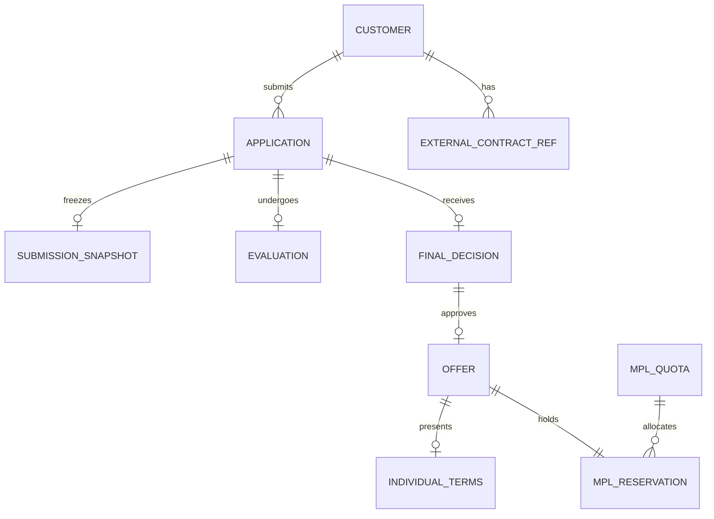
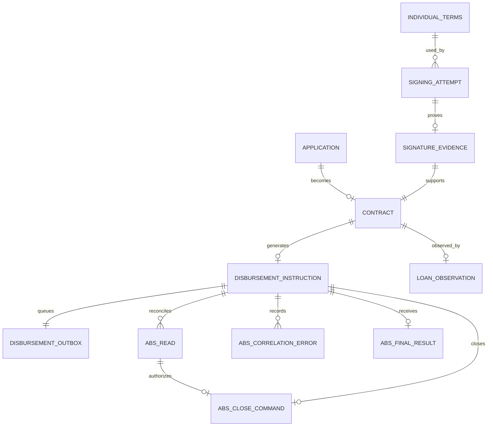

# 2.1. Логическая ER-модель

**Статус:** согласовано для учебного стенда.

Модель покрывает путь Заявки от черновика до результата выдачи и данные, необходимые для ручного рассмотрения, просмотра статуса и сверки с АБС. Источники — [требования 1.6](../03-requirements/1.6-mvp-requirements.md), [статусная модель v3](../02-processes/1.5-status-model.md), [контракт учебной АБС](../06-integrations/abs-contract.md) и [глоссарий](../01-business/1.2-glossary-and-regulations.md). Имена и ключи ниже относятся к логической модели. Конкретные типы PostgreSQL, индексы и миграции определяются на этапе физического проектирования.

## Связи и основные данные

### Клиент, оценка и Предложение

| Сущность | Ключи и основные данные |
|---|---|
| `CUSTOMER` | PK `customer_id` — стабильный внутренний идентификатор синтетического клиента. Текущий признак зарплатного клиента и ссылка на единственный счёт для выдачи в тестовом наборе. |
| `EXTERNAL_CONTRACT_REF` | PK `external_contract_id`, FK `customer_id`, признак действующего договора. Входные данные Legacy для проверки дублей. |
| `APPLICATION` | PK `application_id`, FK `customer_id`, статус v3, время создания, редактируемые сумма и срок черновика, время подачи. Для ручной ветки — время входа и выхода из `UNDERWRITING` и время однократной эскалации. |
| `SUBMISSION_SNAPSHOT` | PK/FK `application_id`. Неизменяемые запрошенная сумма и срок, признак зарплатного клиента, ссылка на версию синтетического профиля. Клиент определяется через Заявку. Время подачи хранится в `APPLICATION` и фиксируется вместе со снимком. |
| `EVALUATION` | PK/FK `application_id`. Факт проверки и ссылка на согласие при наличии, результат AML, результат проверки самозапрета, ссылка на отчёт КБКИ при наличии, месячный зарплатный доход, текущие платежи и платёж по запрашиваемому кредиту, ПДН, результат DE и параметры рекомендации. Согласие и данные проверок поступают на этапе оценки отдельно от снимка подачи. При остановке каскада данные непройденных шагов отсутствуют. |
| `FINAL_DECISION` | PK/FK `application_id`. Источник, итог и время фиксации. Код причины обязателен для автоматического отказа и ручного отказа после команды «Одобрить». При явной команде «Отказать» код необязателен. Для ручного решения обязательны идентификатор андеррайтера и исходная команда. |
| `OFFER` | PK `offer_id`, уникальный FK `application_id` на финальное решение. Неизменяемые сумма, срок, ставка, платёж, ПСК в годовых процентах и рублях. Предложение возможно только при финальном одобрении. |
| `INDIVIDUAL_TERMS` | PK `terms_id`, уникальный FK `offer_id`. Точный экземпляр показанных ИУ — неизменяемые байты документа с типом содержимого, SHA‑256, время первого предоставления и дедлайн Предложения. При ПДН выше 50% сохраняются время первого показа предупреждения и версия текста. |
| `MPL_QUOTA` | PK `quota_id`, уникальная пара `period_key` и `bucket_code`, вместимость тестовой квоты. Единица квоты — одна выдача. |
| `MPL_RESERVATION` | PK/FK `offer_id`, FK `quota_id`, состояние `HELD`, `CONSUMED` или `RELEASED` и время последнего изменения. Одна запись учитывает одну единицу исходной квоты. |

Клиент и внешний договор используют один `customer_id` из синтетического набора. Переход из `DRAFT` сохраняет `application_id`. У принятой подачи есть ровно один снимок со ссылкой на неизменяемую версию синтетического профиля. Сумма и срок для оценки берутся из снимка, а доход, платежи и результаты внешних проверок фиксируются в `EVALUATION`.

На Заявку приходится максимум одно финальное кредитное решение. Результат DE и команда андеррайтера могут отличаться от финального итога. Например, команда «Одобрить» при отсутствии квоты сохраняется вместе с финальным ручным отказом. Отмена или технический сбой до финального решения сами по себе его не создают.

`APPROVED` возможен до предоставления ИУ. При первом предоставлении LoanFlow фиксирует идентификатор и байты ИУ, их хеш, время предоставления и дедлайн на 5 рабочих дней по тестовому календарю. Повторный показ использует тот же экземпляр и дедлайн. При расчёте доступной квоты учитываются резервы в `HELD` и `CONSUMED`; `RELEASED` освобождает единицу. Переход между кварталами находится за рамками стенда.

### Подписание, Договор и выдача

| Сущность | Ключи и основные данные |
|---|---|
| `SIGNING_ATTEMPT` | PK `attempt_id`, FK `terms_id`, время открытия и истечения, счётчик повторных SMS, состояние проверки, время и причина закрытия. Открытая попытка максимум одна на экземпляр ИУ, а следовательно и на Заявку. |
| `SIGNATURE_EVIDENCE` | PK/FK `attempt_id`, идентификатор и хеш подписанных ИУ, результат проверки, канал ПЭП, серверное время успешной проверки, идентификаторы сессии и устройства. Успешное доказательство неизменяемо. |
| `CONTRACT` | PK `contract_id`, уникальные FK `application_id` и `attempt_id` на доказательство. Статус v3, неизменяемая ссылка на счёт зачисления и время окончания охлаждения при его наличии. Время Подписания берётся из доказательства ПЭП. |
| `DISBURSEMENT_INSTRUCTION` | PK `instruction_id`, уникальный FK `contract_id`. Неизменяемые реквизиты отправки — ссылка на счёт, сумма в копейках и валюта `RUB`. Резерв определяется однозначно через Заявку и Предложение. |
| `DISBURSEMENT_OUTBOX` | PK/FK `instruction_id`, состояние ожидания, начала попытки или завершения, время начала и завершения. |
| `ABS_READ` | Составной PK `instruction_id` и `read_seq`, FK `instruction_id`. Оператор, время регистрации запроса, состояние обработки и результат чтения, включая таймаут, конфликт или ошибку корреляции. |
| `ABS_CLOSE_COMMAND` | PK/FK `instruction_id`, `authorized_read_seq` с составным FK на `ABS_READ` того же распоряжения. Идентификатор уполномоченного оператора и время принятия явной команды. |
| `ABS_CORRELATION_ERROR` | PK `error_id`, FK на ожидаемый `instruction_id`, операция отправки или закрытия, тип несовпадения и время обнаружения. Ошибка чтения хранится как исход `ABS_READ`. |
| `ABS_FINAL_RESULT` | PK/FK `instruction_id`, подтверждённое `POSTED` или `CLOSED`, время фиксации в LoanFlow. Для `POSTED` обязательны идентификатор проводки АБС, счёт, сумма, валюта и время зачисления. |
| `LOAN_OBSERVATION` | PK/FK `contract_id`. Тестовое время окончания наблюдения и готовый признак просрочки при его наличии. В отчёте учитываются только подтверждённые выдачи с завершённым к моменту среза наблюдением и известным признаком. |

На Заявку приходится максимум один Договор. Его Заявка, доказательство ПЭП, попытка и экземпляр ИУ должны относиться к одному Предложению. Доказательство использует идентификаторы сессии и устройства из тестового контекста МП. Открытый SMS-код в логическую модель хранения не входит. Счёт берётся из профиля синтетического клиента, фиксируется при создании Договора и переносится в распоряжение. Валидный счёт этого клиента обязателен для тестового сценария успешного Подписания.

На Договор до запуска выдачи приходится ноль распоряжений, после запуска — одно распоряжение и одно задание outbox. Для суммы ниже 50 000 ₽ они создаются в коммите Подписания. Для суммы от 50 000 до 200 000 ₽ включительно время окончания охлаждения — время Подписания плюс 4 часа, для большей суммы — плюс 48 часов. Распоряжение появляется только при допустимом запуске после охлаждения. АБС ведёт счёт и проводку. В LoanFlow остаются ссылка на счёт, отправленные реквизиты и подтверждённый результат АБС. Время окончания охлаждения и время фактического зачисления хранятся как разные события.

## Гарантии переходов

| Операция | Что фиксируется вместе и как отсекаются дубли |
|---|---|
| Подача | `SCORING`, время подачи и снимок фиксируются вместе. Повтор по тому же `application_id` использует исходную подачу. Проверка блокирующих Заявок, Договоров и внешних договоров сериализуется по `customer_id`. Черновики подачу не блокируют. |
| Решение | Из допустимого исходного статуса фиксируются либо финальное одобрение, Предложение, резерв и `APPROVED`, либо финальный отказ и `BANK_REJECTED`. Конкуренция за последний резерв решается по исходной квоте. Выход из `UNDERWRITING` фиксирует время для проверки SLA. |
| Подписание | Под блокировкой Заявки проверяются текущая открытая попытка и серверное время успешной проверки строго до обоих дедлайнов. Фиксируются завершение попытки, доказательство, `CONTRACT_SIGNED` и создание Договора. При откате все условия проверяются заново. Проверка, выполнившая условия под блокировкой, может завершиться коммитом после дедлайна. |
| Истечение и отмена | При истечении Предложения вместе фиксируются `OFFER_EXPIRED`, закрытие активной попытки и освобождение резерва. При допустимой отмене или `SYSTEM_ERROR` освобождается имеющийся резерв. Отказ и запуск выдачи конкурируют за первый зафиксированный переход из `COOLING_OFF`. |
| Запуск и отправка | `DISBURSEMENT_PROCESSING`, распоряжение и задание outbox фиксируются вместе. Воркер отдельным коммитом атомарно фиксирует начало попытки до сетевого вызова. После этого коммита без подтверждения применяется сверка. До коммита возможна первая отправка после восстановления. |
| Результат АБС | Совпавший окончательный результат применяется только к `DISBURSEMENT_PROCESSING`. В одном коммите фиксируются результат АБС, завершение outbox, терминальный статус и переход того же резерва из `HELD` в `CONSUMED` при `POSTED` или `RELEASED` при `CLOSED`. Повтор терминального ответа или чужой ответ состояния не меняет. |

## Корреляция и восстановление сверки { #reconciliation-correlation }

- Для отправки, чтения и закрытия LoanFlow сверяет `instruction_id` из ответа с исходным запросом и сохранённым распоряжением. Для `POSTED` дополнительно сравнивает счёт, сумму и валюту с неизменяемыми реквизитами. Несовпадение оставляет Договор в `DISBURSEMENT_PROCESSING` и резерв в `HELD`. Для чтения ошибка становится исходом соответствующего чтения. Для отправки и закрытия LoanFlow сохраняет диагностическую запись по ожидаемому идентификатору без тела ответа и значений реквизитов. См. [формат и корреляцию в контракте АБС](../06-integrations/abs-contract.md#abs-correlation).
- Номер `read_seq` выдаётся последовательно для одного распоряжения при регистрации чтения до обращения в АБС. Для допуска новой команды закрытия берётся запись с максимальным номером, а не ответ, пришедший последним по времени. Незавершённое чтение, таймаут, конфликт и несовпадение реквизитов закрытие не разрешают. Поздний ответ старого чтения допуск не меняет. Подтверждённый терминальный итог при корректной корреляции может завершить Договор независимо от номера чтения.
- Явная команда уполномоченного оператора принимается, пока Договор в `DISBURSEMENT_PROCESSING` и последнее чтение подтвердило `NOT_FOUND` или `PENDING`. Регистрация чтений, приём команды и фиксация итогового ответа сериализуются по одному распоряжению. LoanFlow фиксирует `ABS_CLOSE_COMMAND` вместе со ссылкой на разрешившее чтение **до вызова АБС**. Эта запись означает, что команда принята, в том числе при сбое до вызова. Пока Договор в обработке, можно повторить ту же команду или прочитать итог по исходному `instruction_id`. Для повтора принятой команды новый разрешающий результат чтения не нужен.

## Контрольные примеры для ревью

- Повтор подачи сохраняет снимок и время. При двух конкурентных подачах одного клиента вторая учитывает уже зафиксированную активную Заявку.
- Две команды «Одобрить» по двум разным Заявкам конкурируют за последнюю единицу квоты. Одна Заявка получает резерв и финальное одобрение, по другой фиксируется финальный ручной отказ. ИУ и дедлайн могут появиться позже коммита одобрения.
- Две последовательные попытки используют один экземпляр ИУ и дедлайн Предложения. Старый ответ не завершает новую попытку. После успешной проверки существует ровно один Договор с доказательством ПЭП.
- Чужой `instruction_id` и `POSTED` с чужим счётом или суммой не списывают резерв. Подтверждённый `POSTED` и `CLOSED` меняют его один раз, в том числе при повторной доставке.
- При двух чтениях, завершившихся в обратном порядке, разрешение закрытия определяется номером регистрации. Сбой до коммита команды требует новой проверки условий. Сбой после коммита команды, но до вызова АБС, допускает повтор уже принятой команды по тому же идентификатору.

Для стенда введены общий ключ клиента, минимальный снимок подачи, один тестовый счёт клиента, единица квоты «одна выдача», хеш точных байтов ИУ и порядок фиксации команд сверки. Банковский состав данных профиля, источник счёта, формат ИУ, полномочия операторов и параметры хранения подлежат отдельному согласованию.
