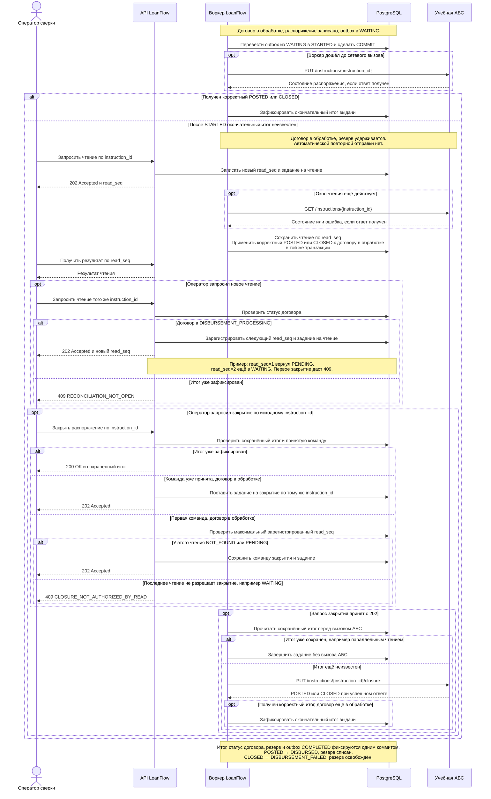

# 4.1. Выдача кредита через учебную АБС

Диаграмма начинается с момента, когда LoanFlow перевёл договор в `DISBURSEMENT_PROCESSING` и в той же транзакции записал распоряжение на зачисление и задание на его отправку. Для кредита без охлаждения это происходит при подписании, для остальных — при запуске выдачи после охлаждения. Сумма уже определена, резерв МПЛ удерживается. [Статусная модель](../02-processes/1.5-status-model.md#2-contract)

## Как читать схему

1. **Успешная выдача.** Читай сверху вниз. Воркер сначала сохраняет `STARTED` в базе и только потом вызывает АБС. Если АБС сразу вернула корректный `POSTED`, блок сверки пропускается. LoanFlow сохраняет время зачисления из ответа, а МП получает статус «Кредит выдан» при чтении договора.
2. **Выдача без окончательного ответа.** `PENDING`, таймаут или сбой сразу после коммита `STARTED` оставляют договор в обработке. Оператор запрашивает чтение в LoanFlow, получает номер `read_seq`, а затем читает результат по этому номеру. Воркер вызывает АБС в пределах 10 секунд с регистрации чтения. Таймаут вызова — до двух секунд и в пределах остатка окна. Пока чтение выполняется, API показывает `WAITING`. Если окно истекло до вызова, результатом будет `TIMEOUT`.
3. **Окончательное закрытие.** Для первой команды `NOT_FOUND` или `PENDING` должен стоять у чтения с самым большим зарегистрированным `read_seq`. Более новое чтение в `WAITING` блокирует первую команду, даже если предыдущее вернуло `PENDING`. Повтор принятой команды по тому же `instruction_id` возвращает `202` при неизвестном итоге, независимо от нового чтения. Если итог уже сохранён, API сразу возвращает его с `200`.
4. **Вызов АБС после `202`.** Воркер обращается к АБС, если при чтении записи итог ещё неизвестен. Если АБС успела зачислить деньги, она вернёт `POSTED`. Если первой зафиксировала закрытие, вернёт `CLOSED` и заблокирует дальнейшее исполнение распоряжения.

Перед фиксацией итога LoanFlow сверяет `instruction_id`, а для `POSTED` ещё счёт, сумму и валюту. Если реквизиты не совпали, договор остаётся в обработке, а резерв удерживается. Повтор подтверждённого результата не меняет резерв второй раз. [Контракт учебной АБС](abs-contract.md) · [Правила сверки и восстановления](../05-api/2.3-openapi-contract.md)
