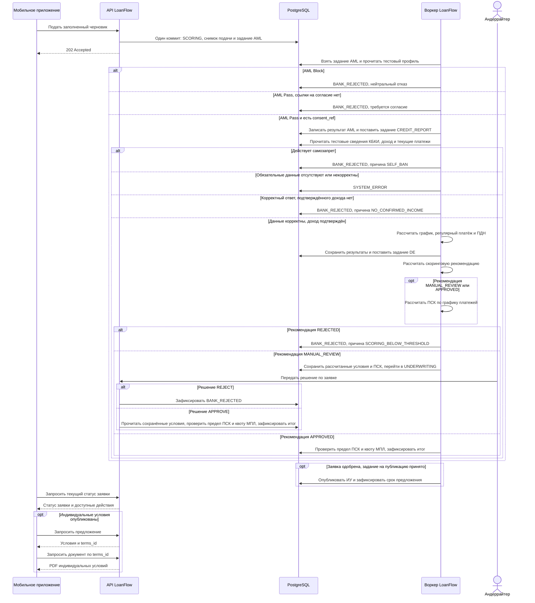

# 4.1. Оценка заявки

Диаграмма начинается с подачи заполненного черновика. `202 Accepted` означает, что LoanFlow принял заявку и поставил оценку в очередь. Итог клиент узнаёт отдельным запросом. [Требования MVP](../03-requirements/1.6-mvp-requirements.md) · [Статусная модель](../02-processes/1.5-status-model.md)

На стенде наличие `consent_ref` означает действующее согласие. При `AML Block` или отсутствии согласия этап `CREDIT_REPORT` пропускается. Корректный ответ с нулевым доходом или `null` даёт `NO_CONFIRMED_INCOME`. Если одновременно отсутствует обязательное поле текущих платежей, результатом будет `SYSTEM_ERROR`. [Постановки задач 3.3](../03-requirements/3.3-calculation-tasks.md)

При превышении предела ПСК или исчерпании квоты результат — `BANK_REJECTED`. При успехе LoanFlow одним коммитом фиксирует решение, `APPROVED`, предложение, резерв и задание на публикацию ИУ. В МП сначала может появиться одобрение, а условия становятся доступны после публикации. [Требования MVP](../03-requirements/1.6-mvp-requirements.md) · [Контракт API LoanFlow](../05-api/2.3-openapi-contract.md)

Для временных сбоев оценки и публикации предусмотрены три попытки всего. После первой ошибки воркер ждёт 1 секунду, после второй — 3 секунды. Постоянная техническая ошибка или исчерпание попыток переводит заявку в `SYSTEM_ERROR` с освобождением имеющегося резерва. [Правила повторов](../03-requirements/1.6-mvp-requirements.md#stand-retries)
