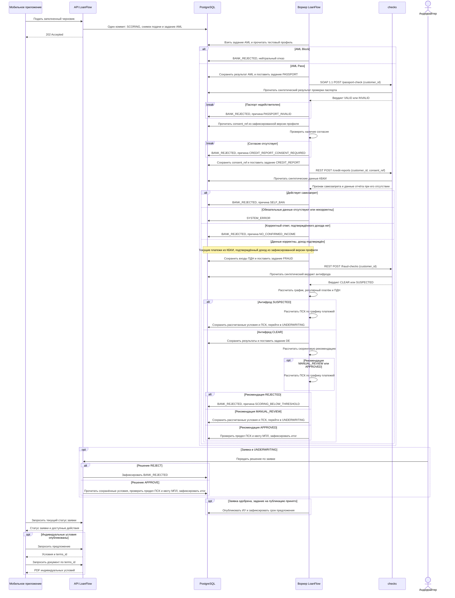

# 4.1. Оценка заявки

Диаграмма начинается с подачи заполненного черновика. `202 Accepted` означает, что LoanFlow принял заявку и поставил оценку в очередь. Итог клиент узнаёт отдельным запросом. [Требования MVP](../03-requirements/1.6-mvp-requirements.md) · [Статусная модель](../02-processes/1.5-status-model.md)

Непустая `consent_ref` означает действующее учебное согласие. LoanFlow проверяет полноту отчёта КБКИ до проверки подтверждённого дохода. Корректный отчёт с доходом `0` или `null` в профиле даёт `NO_CONFIRMED_INCOME`. Если в отчёте без самозапрета отсутствуют текущие платежи, заявка получает `SYSTEM_ERROR`, в том числе при доходе `null`. [Постановки задач 3.3](../03-requirements/3.3-calculation-tasks.md) · [Маппинги полей](4.2-field-mappings.md)

При превышении предела ПСК или исчерпании квоты результат — `BANK_REJECTED`. При успехе LoanFlow одним коммитом фиксирует решение, `APPROVED`, предложение, резерв и задание на публикацию ИУ. В МП сначала может появиться одобрение, а условия становятся доступны после публикации. [Требования MVP](../03-requirements/1.6-mvp-requirements.md) · [Контракт API LoanFlow](../05-api/2.3-openapi-contract.md)

Для временных сбоев оценки и публикации предусмотрены три попытки всего. После первой ошибки воркер ждёт 1 секунду, после второй — 3 секунды. Постоянная техническая ошибка или исчерпание попыток переводит заявку в `SYSTEM_ERROR` с освобождением имеющегося резерва. [Правила повторов](../03-requirements/1.6-mvp-requirements.md#stand-retries)
