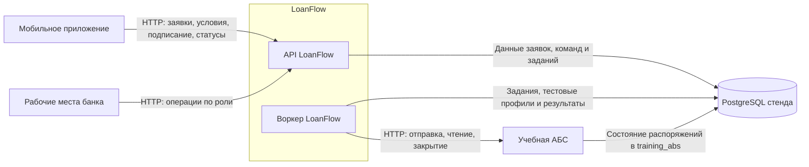

# 4.1. Интеграционная архитектура

На схеме показан текущий учебный стенд LoanFlow. Мобильное приложение (МП) и рабочие места обращаются к API по HTTP. API сохраняет команды и задания в PostgreSQL. Воркер берёт задания из базы и выполняет длительные операции, пока клиент или оператор может читать текущий статус через API.

- **Рабочие места банка.** Контакт-центр и отделение запрашивают сведения о заявках и договорах. Андеррайтер принимает ручное решение, руководитель читает эскалации и отчёт, оператор сверки работает с распоряжениями. [Требования MVP](../03-requirements/1.6-mvp-requirements.md) · [Контракт API LoanFlow](../05-api/2.3-openapi-contract.md)
- **Оценка.** Результаты AML и КБКИ, а также сведения о доходе и платежах хранятся в тестовом профиле. LoanFlow рассчитывает график, ПДН и скоринговую рекомендацию. Проверка ПЭП и отправка учебного SMS выполняются локально. Вопрос о числе запросов в КБКИ относится к будущей интеграции. [Диаграмма оценки заявки](4.1-application-assessment.md)
- **Выдача.** Учебная АБС — отдельный HTTP-сервис. На стенде она хранит собственное состояние в схеме `training_abs` того же PostgreSQL. Подтверждение проводки исходит от АБС, а LoanFlow фиксирует договор, резерв и итог распоряжения. [Диаграмма выдачи и сверки](4.1-abs-disbursement.md) · [Контракт учебной АБС](abs-contract.md)
