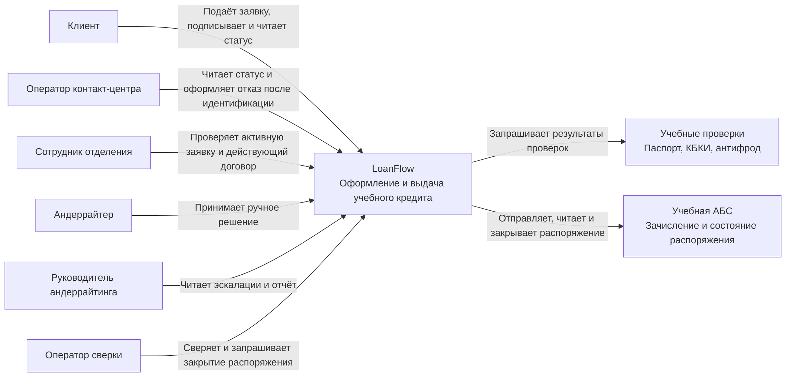
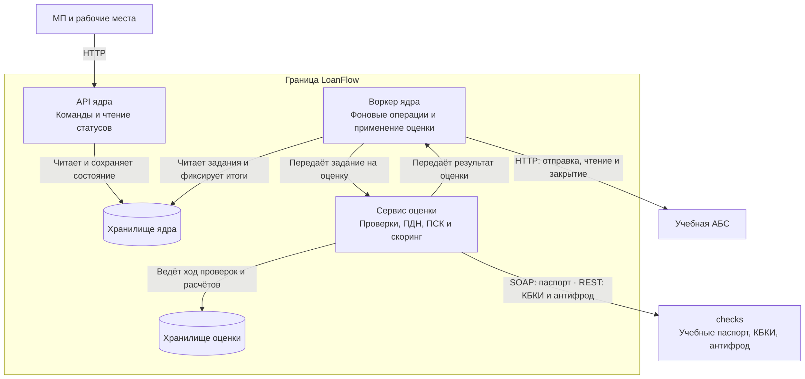

# 5.1. Декомпозиция LoanFlow

В целевой архитектуре сервис оценки выполняет проверки и расчёты и возвращает рекомендацию. Ядро LoanFlow принимает итоговое решение и ведёт заявку от подачи до выдачи. Учебная АБС проводит зачисление и подтверждает его итог. За исходную точку берём [архитектуру действующего стенда](../06-integrations/4.1-integration-architecture.md), где оценка и применение решения выполняются в одном воркере.

## C1. Контекст LoanFlow { #c1-context }

Клиент работает через МП. Рабочие места обращаются к API в пределах прав своей роли. При проверке действующего договора отделение учитывает данные учебного набора Legacy. Внешние проверки на стенде выполняет сервис `checks` на синтетических данных. [Роли и сценарии](../03-requirements/1.6-mvp-requirements.md) · [Контракт API](../05-api/2.3-openapi-contract.md) · [Контракт АБС](../06-integrations/abs-contract.md)

## C2. Контейнеры целевого стенда { #c2-containers }

| Владелец | Данные и ответственность |
|---|---|
| Ядро LoanFlow | Заявка, снимок подачи, принятый результат оценки, ручное рассмотрение, итоговое решение, предложение, квота и резерв, подписание, договор и сверка. API и воркер работают с хранилищем ядра. |
| Сервис оценки | Ход проверок, промежуточные результаты и расчёты. Сервис использует зафиксированные условия подачи и правила оценки. |
| Учебные системы | `checks` отвечает по синтетическому профилю. АБС владеет состоянием распоряжения и проводкой. |

Хранилища на схеме обозначают границы владения данными. После разделения ядро использует свою сохранённую копию принятого результата оценки, в том числе для ручного решения и предупреждения о ПДН. Учебная имитация SMS остаётся в подписании. [Маппинги полей](../06-integrations/4.2-field-mappings.md)

## Что пересекает границу оценки

- **Вход.** Привязка к принятой подаче, синтетический идентификатор клиента, зафиксированные сумма и срок, версия правил оценки и нужные данные из зафиксированной версии профиля. Для расчёта нужны подтверждённый доход и текущие платежи. Доход берётся из профиля, платежи — из КБКИ после проверки согласия.
- **Результат.** Рекомендация к одобрению, ручному рассмотрению или отказу с внутренней причиной. Технический сбой передаётся отдельным исходом. Для одобрения и ручного рассмотрения ядро получает рассчитанные условия, результат точной проверки предела ПСК и ключ квоты, состоящий из периода и категории. Для предупреждения нужен признак ПДН строго выше 50%. Доступность квоты ядро проверяет на момент решения. [Расчёты 3.3](../03-requirements/3.3-calculation-tasks.md)

## Где сохраняется результат

1. Подтверждение подачи означает, что ядро одной транзакцией сохранило снимок подачи, статус `SCORING` и задание на оценку. Ядро применяет автоматический результат только к исходной подаче в статусе `SCORING`. Если клиент уже отменил заявку, поздний результат её не возобновляет.
2. При переходе в `UNDERWRITING` рассчитанные условия уже сохранены в ядре. Новая ручная команда допустима только в этом статусе. После отмены она получает `409 UNDERWRITING_STATE_CONFLICT`. Ручной `APPROVE` использует сохранённые условия и может завершиться итоговым отказом по пределу ПСК или исчерпанию квоты. При одобрении решение, статус `APPROVED`, предложение, резерв и задание на публикацию ИУ сохраняются одной транзакцией.
3. Доказательство подписи, подписанный статус заявки и договор сохраняются вместе. При подтверждённом итоге выдачи ядро одной транзакцией меняет статус договора, закрывает задание и списывает либо освобождает резерв. [Статусная модель](../02-processes/1.5-status-model.md) · [Выдача и сверка](../06-integrations/4.1-abs-disbursement.md)

В [5.2](https://github.com/denis11134/loanflow/issues/25) определяются события, топики Kafka и AsyncAPI. В [5.3](https://github.com/denis11134/loanflow/issues/26) целевое разделение переносится в код.
